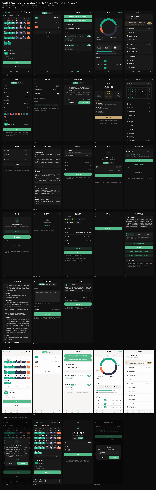

# 极简排班 3.5.0 — APK 解包 · 前端界面分析 · 高保真复刻

> 仓库：<https://github.com/xonec/jijian>

> 对象：cn.jianyun.workplan「极简排班」v3.5.0（versionCode 36，44,927,974 B）
> 结论先行：这是一个 **原生 Android + Kotlin + Jetpack Compose** 应用（不是 H5/uni-app/RN），界面全部是硬编码 Compose，可以 1:1 复刻。
> ⚠️ **免责声明**：本仓库仅用于技术学习与逆向分析研究，与「极简排班」原作者/杭州简蕴科技有限公司无任何关联；不含原 App 代码/资源的分发授权。请勿将本项目或其素材用于商业上架、冒充官方或侵犯他人权利。
> 已交付：完整解包工程 + 21 个路由/5 个 Tab 的界面规格 + 设计令牌 + 素材 + **可直接交互的 HTML 高保真原型**（含官方截图对照）。

---

## 一、交付物导览

| 路径 | 内容 |
|---|---|
| [uniapp/](uniapp/) | ⭐⭐ uni-app + uniCloud 复刻工程（Vue3 + Vite；23 个页面全部完成、uni-id 登录、本地/云备份、WebDAV 云备份、权限引导等业务页、12 个共享组件、本地 mock ⇄ uniCloud 双后端、13 个集合 schema + 7 个云函数、**提醒/系统日历原生能力（见 [REMINDER.md](uniapp/REMINDER.md)）**、**桌面小组件（配置页 + 原生 AppWidget 插件源码，见 [WIDGET.md](uniapp/WIDGET.md)）**、**会员赞助/支付宝支付（mock 可演示，见 [PAYMENT.md](uniapp/PAYMENT.md)）**、H5 构建通过、60+ 张截图） |
| [prototype/](prototype/) | ⭐ 高保真 HTML 复刻原型（index.html 可交互 + board.html 画廊 + compare.html 对照 + shots/ 截图），也是 uniapp 版的视觉基准 |
| [analysis/screens/](analysis/screens/) | 界面规格：inventory / navigation / components / screen-01~14（逐屏结构 + dp + 文案 + 代码行号） |
| [analysis/rea/](analysis/rea/) | ⭐ REA/JADX 深度代码提取：367 类 Java 源码 + 13 类 smali/partial、436 类成员清单、262 个 Composable 索引、15 组交叉引用、反编译质量对比 |
| [analysis/theme/](analysis/theme/) | 设计令牌：design-tokens.md/.json/.css、strings.zh.md（748 条真实文案）、copy-options.md、resource-map.tsv |
| [analysis/reference/](analysis/reference/) | 联网取证：官方商店截图 25 张、旧版全屏截图、教程视频及抽帧、features.md、store-metadata.json；`real-screens/` 为**安装官方 APK 后抓取的真机界面 24 张**（含暗色）+ 与 uni-app 的像素对照板 |
| [analysis/pixel/](analysis/pixel/) | 像素级复刻可行性实测：同视口（411dp）逐屏 diff 指标、对照板、差异热图、复现脚本（空态页差异 3.4%，Tab 栏 0.8） |
| [.github/workflows/](.github/workflows/) | ⭐ GitHub Actions：`ci.yml`（静态检查/构建/23 路由冒烟）+ `android-release.yml`（tag/手动 → 签名 APK + Release），用法见 [release/CI.md](release/CI.md) |
| [release/](release/) | ⭐ **可安装签名 APK（WebView 外壳版，347KB）** + 构建脚本（aapt2/javac/d8/apksigner）+ keystore 说明 + 发布指南（正式 App 包路径/上架清单） |
| [analysis/qa/](analysis/qa/) | 测试计划与报告：静态检查、23 路由 H5 冒烟（23/23）、APK 安装/交互/冷启动测试、真机能力清单 |
| [analysis/feasibility-uniapp-unicloud.md](analysis/feasibility-uniapp-unicloud.md) | ⭐ uni-app + uniCloud 能否完美复刻：能力矩阵、无广告方案修订、硬缺口状态（提醒/日历已实现；小组件源码已提供待编译）、结论与推荐路线 |
| [assets_extracted/](assets_extracted/) | App 自有素材 25 件（图标/小组件预览/云品牌图/字体/CSS/230 中国色） |
| [decoded/](decoded/) | apktool 解码产物：AndroidManifest.xml（可读）+ 还原命名的 res + assets + lib |
| [jadx-src/](jadx-src/) | jadx 反编译源码（437 MB，含 cn/jianyun/** 全部业务代码） |
| [raw/](raw/) | APK 直接解压的原样内容（对比用） |
| [tools/](tools/) | apktool-cli.jar、jadx 1.5.6 发行版、辅助分析脚本 |

**先看这两张图**：[compare_board.png](prototype/shots/compare_board.png)（官方截图 vs 原型）、[gallery_board.png](prototype/shots/gallery_board.png)（全部界面一览）。

---

## 二、APK 基本信息

| 项 | 值 |
|---|---|
| 包名 / 应用名 | cn.jianyun.workplan / 极简排班 |
| 版本 | versionName 3.5.0，versionCode 36 |
| SDK | minSdk 26，targetSdk 33，compileSdk 34 |
| 大小 / 校验 | 44,927,974 B；md5 3334b96094774662d9bf40f7e78563fd（与应用宝商店 md5 一致，来源可信） |
| 开发者 | 杭州简蕴科技有限公司（浙ICP备2023038861号-5A） |
| 技术栈 | Kotlin 1.8 / Jetpack Compose (Material3) / Hilt / Navigation-Compose / Glance 桌面小组件 / Retrofit+OkHttp+Gson / Coil |
| 代码规模 | 9 个 dex；全包 18,130 个类；App 自有类 620 个（cn.jianyun.*）；自有资源 77 项（资源表共 7,426 条） |
| 三方 SDK | 穿山甲 Pangle、倍孜 beizi、广点通 GDT、快手 KS、阿里天目/安全 SDK、Log4j、XPP3（均为广告/加固，可忽略） |
| 资源混淆 | 资源文件路径被扁平化重命名（res/zq.xml、res/AB.png …，AndResGuard 类工具），但 **resources.arsc 中的资源名完整保留**，apktool 可正常还原 |
| 加固 | 无壳。dex 可直接反编译（jadx 仅 3 个类失败，全部业务代码可读） |

---

## 二·五、两种复刻产物怎么选

| | [prototype/](prototype/) HTML 原型 | [uniapp/](uniapp/) uni-app + uniCloud 工程 |
|---|---|---|
| 定位 | 设计走查 / 视觉基准 / 快速演示 | 可交付、可二次开发的跨端工程（H5 / 微信小程序 / App） |
| 技术 | 原生 HTML/CSS/JS（无依赖） | Vue3 SFC + Vite + uniCloud 云函数、数据库 schema |
| 数据 | 前端 mock | 本地 mock ⇄ uniCloud 一键切换（config.js useCloud） |
| 打开 | python3 -m http.server | pnpm dev:h5（详见 uniapp/README.md） |
| 页面 | 13 屏 + 5 浮层 | 5 Tab + 8 二级页（pages.json 路由） |

## 三、解包方法与产物（可复现）

    # 1) 资源 + 清单（-s 表示不生成 smali，代码交给 jadx）
    java -cp tools/apktool-cli.jar brut.apktool.Main d -f -s -o decoded app.apk

    # 2) 反编译 dex（9 个 dex → Java/Kotlin 源码，保留 Kotlin Metadata）
    java -Xmx10g -cp "tools/jadx-dist/lib/*" jadx.cli.JadxCLI -d jadx-src -j 8 --no-res app.apk

    # 3) 资源表（用于混淆名 → 原始名映射）
    $ANDROID_SDK/build-tools/34.0.0/aapt2 dump resources app.apk > res.txt

- [decoded/AndroidManifest.xml](decoded/AndroidManifest.xml)：可读清单。App 只有 1 个自有 Activity（main.MainActivity）+ 1 个 Glance 小组件 Receiver，其余全是广告 SDK 组件。
- [decoded/res/](decoded/res/)：layout/drawable/values 全部还原为原始资源名（730 个 layout、1400+ drawable，绝大多数来自三方库）。
- [jadx-src/sources/cn/jianyun/](jadx-src/sources/cn/jianyun/)：业务代码，模块结构：

    workplan/
    ├─ main/            MainActivity、Navigation 图、设置/用户/通知/会员、FAQ、协议
    ├─ module/schedule/ 核心业务：首页 main、日历 biz、班次 work、轮班 plan、提醒 alarm、统计 stat、项目 project、分享 share、云备份 cloud、设置 setting、小程序导入 wechat
    ├─ ui/component/    自研 Compose 组件库（nav / form / bottomdialog / graph）
    ├─ ui/theme/        ColorKt / ThemeKt / TypeKt（设计系统）
    ├─ widget/          Glance 桌面小组件（月历/班次）与配置页
    └─ hilt/ api/ util/ model/ vm/

---

## 四、前端架构结论（决定"能不能复刻"）

1. **全 Compose，无 H5/小程序/服务端 JSON 驱动**。所有页面都是写死的 Composable；服务端只下发内容数据（公告、节日/农历、FAQ、更新说明、会员商品）。因此界面可以 1:1 还原。
2. **单 Activity + 单 NavHost**：注册 21 个 composable 路由（[inventory.md](analysis/screens/inventory.md)），另有 2 个入口别名（Home / Schedule）。
3. **主界面是 5 个底部 Tab，Tab 切换是 ViewModel 状态位（不是路由）**：排班 / 班次 / 提醒 / 统计 / 我的（[ScheduleMainViewKt.java:351-447](jadx-src/sources/cn/jianyun/workplan/module/schedule/views/ScheduleMainViewKt.java)）。「班次」页内还有「班次 / 轮班」分段器。
4. **自研组件库**决定视觉风格：PageView / SimpleSubAppPageView（页面容器）、HeaderView、PanelView、GroupView、BoxView、SwipeRowView、NavItemView、SegmentPicker、FormItem、Dialog、BottomSheet、折线/柱状/饼图。
5. **图标是字体不是图片**：全部 UI 图标来自 Remix Icon 字体子集 res/font/remixicon.ttf（17 KB，79 个字形），码点表在 IconFont.java —— 复刻时可直接复用同一字体。
6. **主题色固定 #55BB8A**（麦苗绿），明暗两套语义色写死在 ColorKt.java；3.5.0 没有整体换肤入口（Color 的 setter 无调用方）。230 个中国传统色实际用于「班次颜色 / 小组件配色」。

---

## 五、界面清单（21 路由 + 5 Tab + 浮层）

| # | 界面 | 路由 / Composable | 说明 |
|---|---|---|---|
| 1 | 主界面 5 Tab | Home → ScheduleMainView | 排班 / 班次 / 提醒 / 统计 / 我的，Tab 为状态位 |
| 2 | 排班首页 + 日历 | ScheduleHomeView + ScheduleCalendarView | 月份栏、提示条、班次统计条、月历、选中日班次、备注、开启排班 |
| 3 | 班次 / 轮班管理 | ScheduleWorkManageView / SchedulePlanManageView | 列表、添加、排序；顶部班次/轮班分段器 |
| 4 | 班次编辑 | ScheduleWorkEdit | 普通/组合班次、名称、全天、上下班时间、颜色、样式预览 |
| 5 | 轮班编辑 | SchedulePlanEdit | 周期轮班：轮班名称、周期、选择班次、排序 |
| 6 | 提醒管理 / 编辑 | ScheduleAlarmManageView / ScheduleAlarmEdit | 提醒卡片、日历授权、提前量、强提醒、重复 |
| 7 | 排班统计 | ScheduleStatView | 区间、班次占比饼图、时长统计、排班明细、导出 Excel |
| 8 | 我的 / 排班设置 | ScheduleSettingView | 用户卡、会员、项目、备份、分享导入、风格、小组件、FAQ、协议 |
| 9 | 项目管理 | ScheduleProjectManagerView | 多排班项目（班组）：增删改、排序、切换当前 |
| 10 | 分享与导入 | ScheduleShareView | 6 位秘钥分享/导入、分享图片 |
| 11 | 本地备份 / 云备份 | LocalBackup / WebDAV 系列 / ScheduleCloudManage | 本地目录备份、坚果云/Koofr/OneDrive/GoogleDrive(WebDAV) |
| 12 | 会员 | VipPage | 3 元/月、12 元/年、18 元永久；权益：支持开发、无广告秒开、专属客服 |
| 13 | 我的信息 / 登录 | UserDetailView / LoginDialog | 账号仅用于绑定付费与反馈 |
| 14 | 桌面小组件配置 | WidgetConfigView | 月历/班次两种样式、字号、12 个颜色项、透明度、暗黑配色 |
| 15 | 通知权限 / 日历权限 | NotifySettingView / 授权按钮 | 华为/小米/荣耀等机型引导 |
| 16 | 常见问题 / 协议 / 小程序导入 | QuestionView / UserPolicy / PrivatePolicy / WechatView | FAQ 由服务端下发 |
| 17 | 排班操作面板 | ScheduleOperView | 自定义排班 / 周期轮班 / 清除 / 上一天 / 下一天 |
| 18 | 浮层 | MonthChooseView / BottomScheduleConfigView / BottomProjectChooseView / 班次选择 / 备注输入 | 月份选择、日历显示设置、项目选择、班次选择、备注 |

逐屏细节（结构、尺寸、颜色、文案、代码行号）见 [analysis/screens/](analysis/screens/) 与 [analysis/screens/inventory.md](analysis/screens/inventory.md)。

---

## 五·五、REA 深度代码提取（analysis/rea/）

用 [REA](https://github.com/morluto/rea)（MCP + CLI 逆向工具）及其 jadx-headless-mcp 0.7.1 引擎，对 APK 做了类/方法级、带证据的代码提取（补充 jadx-src/ 并做质量校验）：

| 产物 | 内容 |
|---|---|
| [source/](analysis/rea/source/) + [source-smali/](analysis/rea/source-smali/) + [source-partial/](analysis/rea/source-partial/) | 367 类 Java 源码（10MB/148k 行）+ 13 类 smali 回退 + 13 类 partial Java |
| [inventories/](analysis/rea/inventories/) + [METHODS.tsv](analysis/rea/METHODS.tsv) | 436 个类的成员清单（方法签名/字段/内部类） |
| [COMPOSE-UI.tsv](analysis/rea/COMPOSE-UI.tsv) | 262 个 Compose Composable 方法索引（91 个类） |
| [XREF-MAP.md](analysis/rea/XREF-MAP.md) + [xrefs/](analysis/rea/xrefs/) | 交叉引用：BaseRepository(69 类/237 处)、HeaderViewKt(27/66)、FormItemKt(21/86)、Router(9/50) 等 |
| [DECOMPILE-QUALITY.md](analysis/rea/DECOMPILE-QUALITY.md) | 与旧 jadx 批量对比：202 类旧输出带告警，REA 重跑后 **34 类恢复干净 Java**；13 类仅 smali（附 partial Java） |
| [CODE-INDEX.md](analysis/rea/CODE-INDEX.md) / [README.md](analysis/rea/README.md) | 包级统计、Composable 索引、方法最多 Top30、复现步骤 |

关键数据：APK 类总数 26,578、应用自有类 436、方法 5,290、Composable 262、权限 25、签名 v2（CN=lihe/O=jianyun，self_consistent）。

## 五·六、官方真机截图与像素对照（analysis/reference/real-screens/）

在 Android 14 模拟器（arm64，1080×2400）安装官方 APK 3.5.0 后，用 adb + UIAutomator 自动导航抓取 **24 张官方真实界面**（浅色 + 暗色），并与 uni-app 复刻版做左右对照：

| 产物 | 内容 |
|---|---|
| [real-screens/](analysis/reference/real-screens/) | 24 张官方截图（首页/5 Tab/登录/本地备份/分享/小组件/小程序导入/FAQ/反馈/协议/隐私/更新说明/会员/班次编辑/轮班/项目管理 + 暗色首页与我的） |
| [compare-real-vs-uniapp-main.png](analysis/reference/real-screens/compare-real-vs-uniapp-main.png) | 5 个主 Tab：官方（左）vs uni-app（右） |
| [compare-real-vs-uniapp-sub.png](analysis/reference/real-screens/compare-real-vs-uniapp-sub.png) | 6 个子页面同上对照 |
| [xref-verification.md](analysis/screens/xref-verification.md) | 用 77 组 xref 校验界面文档：20 个注册路由（修正原 21）、首启隐私弹窗确实存在、非路由子页清单、导航入口热度 |

真机截图确认的新事实：首启隐私同意弹窗（同意/不同意）、登录是弹窗非页面、我的 Tab 标题为「排班设置」、VIP 3 元/月 12 元/年 18 元永久、反馈入口是腾讯兔小巢 WebView。

彩蛋：截图流程由 **REA MCP** 完成（`install_adb_package` 记录 APK sha256、`start_adb_app` 启动、`capture_adb_screen` 可取证），REA 已注册进 DSH，见 [analysis/rea/README.md](analysis/rea/README.md) §8。

## 五·七、像素级复刻实测（analysis/pixel/）

把官方截图裁到**内容区 411×842dp**、uni-app H5 用同一设备参数重渲染后逐屏 diff（3px 高斯模糊抑制字体抗锯齿）：

| 页面 | 平均绝对差 | 差异>16 像素占比 | Tab 栏分区 |
|---|---|---|---|
| 班次（两边空态） | **4.20** | **3.4%** | **0.8** |
| 首页 | 29.10 | 30.4% | 1.1 |
| 提醒 | 13.87 | 16.5% | 0.8 |
| 统计 | 16.06 | 14.0% | 5.2 |
| 我的 | 11.18 | 14.2% | 4.8 |

结论：**结构/颜色/图标/Tab 栏已接近逐像素**（空态页 3.4% 差异），当前大差异主要来自①官方空态 vs 复刻演示数据 ②Android Noto Sans 与 macOS 苹方字体差异 ③提醒页权限条等局部组件。

要真正「同屏难辨」还需 4 步：数据状态对齐 → H5 内嵌 Noto Sans SC → 模拟状态栏/导航栏 → 按 `diff-*.png` 逐屏收敛。详见 [analysis/pixel/README.md](analysis/pixel/README.md)。

## 五·八、uni-app + uniCloud 能复刻到什么程度

| 目标 | 可行性 | 说明 |
|---|---|---|
| 视觉 1:1 | ✅ | 像素实测空态页 3.4%、Tab 栏 0.8；对齐数据/字体后 <2% |
| 功能等价（Android App） | ✅ ~97-98%（无广告方案） | uni-app App + 2 个 UTS 插件（小组件/提醒日历）+ 6 个云函数 |
| H5/小程序完整功能 | ⚠️ ~85-90%（无广告方案） | 仍受限于小组件/原生闹钟/本地文件；广告已排除 |
| 数学意义 100% | ❌ | 闭源 SDK、字体渲染、系统层、支付/广告资质，需原生 Kotlin 才能全等 |

详细能力矩阵、硬缺口与「无广告方案」修订见 [analysis/feasibility-uniapp-unicloud.md](analysis/feasibility-uniapp-unicloud.md) §8。复刻工程已内置 `config.js: noAds`：默认隐藏「去广告」入口与「无广告秒开」权益。

## 六、设计系统（复刻要点）

| 设计令牌 | 亮色 | 暗色 | 出处 |
|---|---|---|---|
| 页面背景 | #F6F5F4 | #111111 | ColorKt.java:16 / 22 |
| 卡片/面板 | #FDFDFD | #191919 | ColorKt.java:15 / 23 |
| 选中/悬浮 | #EEEEEE | #222222 | ColorKt.java:17 / 24 |
| 主 / 次 / 三级文字 | #000000 / #222222 / #999999 | #FFFFFF / #DDDDDD / #888888 | ColorKt.java:18-20 / 25-27 |
| 强调色 | #55BB8A（固定，月份标题/选中态/按钮） | 同左 | ColorKt.java:10 |
| 日历态 | 今天=红字加粗+8%红底；选中日=绿20%+描边+6dp；月水印 80sp/10% | 同左 | screen-02-calendar.md |
| 删除 / 重要 / VIP / 私密 | #F87679 / #EE3F4D / #C5A874 / #806D9E | 同左 | ColorKt.java:9,12-14 |
| 分割线 | #E5E5E5 | — | values/colors.xml |
| 字体 | 系统默认 | 同左 | TypeKt.java:35 |
| 正文 | 16sp / Normal / lineHeight 24sp / letterSpacing 0.5sp | 同左 | TypeKt.java:36 |
| 常用字号 | 12 / 13 / 15sp（标题 20sp，字重 Medium 500 最多） | 同左 | 全量统计 |
| 圆角 | 卡片 12dp 最高频（149 次），次 20/10dp；标签 4/6dp | 同左 | 全量统计 |
| 间距 | 5dp / 10dp 为主，页面边距 12dp（非 4/8 栅格） | 同左 | 全量统计 |
| 图标 | Remix Icon v4.3 子集 79 枚 | 同左 | res/font/remixicon.ttf + IconFont.java |
| 班次/小组件配色 | 230 个中国传统色（8 组） | 同左 | assets/data/color.json |

可直接引用的产物：[design-tokens.css](analysis/theme/design-tokens.css)（CSS 变量 + 明暗切换 + 图标字体）、[design-tokens.json](analysis/theme/design-tokens.json)、[icon-font.css](assets_extracted/fonts/icon-font.css)、[icon-map.json](assets_extracted/fonts/icon-map.json)。

---

## 六·五、uni-app + uniCloud 工程（uniapp/）—— 推荐从这里继续开发

    cd uniapp
    pnpm install          # 已完成
    pnpm dev:h5           # http://127.0.0.1:5273   （?theme=dark 可强制暗色）
    pnpm build:h5         # 产物 dist/build/h5
    pnpm dev:mp-weixin    # 微信小程序（微信开发者工具打开 dist/dev/mp-weixin）
    pnpm dev:app          # App（HBuilderX）

**已完成**
- 23 个页面：5 个 Tab（排班/班次/提醒/统计/我的）+ 18 个二级页（班次编辑/提醒编辑/分享导入/会员/小组件/项目管理/FAQ/我的信息 + 登录/本地备份/云备份/WebDAV 账号·编辑·我的文件/通知权限/用户协议/在线反馈/小程序导入），全部通过构建与逐页截图验证。
- 10 个共享组件：page-frame（自绘顶栏+tabbar+主题）、app-tabbar、calendar-grid（月历/农历/今日红/选中绿/月水印）、shift-badge、donut-chart、seg-tabs、app-switch、cell-row、ri-icon、app-sheet、app-dialog。
- 设计系统：src/styles/tokens.scss（亮/暗两套 CSS 变量，取自 APK ColorKt）+ base.scss（全局组件类）+ icons.scss（Remix Icon 79 枚，22KB base64 内联，兼容小程序）。
- 数据层：src/services/api.js 统一 API，默认本地 mock（uni storage），改 config.js useCloud=true 即切到 uniCloud 云函数，页面零改动。
- uni-id 登录：内置官方 uni-id-common v1.0.16 + uni-config-center；cloudfunctions/user（注册/登录/退出/改密/信息，pbkdf2 密码 + JWT），业务云函数按 token 的 uid 隔离数据（游客回落 deviceId，登录后自动迁移游客数据）。
- uniCloud 后端：workplan（16 action）+ user（6 action）+ backup（快照 list/create/restore/delete）+ webdav（账号/文件，uniCloud.httpclient 真实 WebDAV，AES 加密密码）+ feedback + seedDemo；database/ 11 个 schema（jy_* + uni-id-users + jy_backup + jy_webdav + jy_feedback）。
- 文档：[uniapp/README.md](uniapp/README.md)、[uniapp/UNICLOUD.md](uniapp/UNICLOUD.md)（创建空间/关联/上传/切换/验证清单）。
- 截图：[shots/gallery_board.png](uniapp/shots/gallery_board.png)（全部页面总览）+ 18 张单页 PNG。

## 七、高保真复刻原型（prototype/）

    cd prototype && python3 -m http.server 8765
    # 打开 http://127.0.0.1:8765/index.html

- 13 个可切换界面：排班首页、班次/轮班、提醒、统计、我的、添加班次、添加提醒、分享与导入、会员、桌面小组件、项目管理、常见问题、我的信息。
- 5 个浮层/状态：月份选择、日历显示设置、项目选择、班次选择、备注弹窗、首页排班模式（底部操作条）。
- 明暗双主题 + 一周开始日切换（周一/周日，APK 可配置）· 真实 remixicon 图标 · 真实中文文案。
- 截图：`shots/` 26 张 2x PNG；`shots/gallery_board.png` 全界面一览；`shots/compare_board.png` 官方截图左右对照。
- 实现说明与代码出处见 [prototype/README.md](prototype/README.md)。

---

## 八、还原度与已知存疑

**高置信（有代码证据）**：5 Tab 结构、图标、明暗配色、字体/字号/圆角、首页与日历结构（今天=红字 / 选中日=绿 20%+描边 / 月水印 / 农历三色）、班次色块、提醒卡片、统计饼图、设置页条目、添加班次/提醒表单、日历显示设置项、页面容器样式。

**中置信（素材推断）**：官方暗色营销图中的班次示例色（#1BA784 / #303048 / #F8723D）与 2024-09 的排班节奏、统计占比；营销图无顶栏/底栏，已用旧版全屏截图 + 教程视频补齐。

**存疑 / 未还原**：

1. 官方暗图中 14、29 日的蓝色「调班」角标：反编译源码与资源中检索不到字面量，推断来自节假日调休数据，原型按截图示意保留。
2. 桌面小组件的真实桌面效果没有公开截图；已按 Glance 代码 + APK 内置预览图 assets_extracted/widget/quick.png 还原配置页与预览。
3. 「我的」页无官方全屏截图，按 ScheduleSettingViewKt 的真实条目与图标还原。
4. App 整体换肤在 3.5.0 未接线（Color setter 无调用方）；若产品后续开放，把 --primary 做成变量即可。
5. 广告相关界面（开屏、激励视频、Banner）属于三方 SDK，未复刻（与产品界面无关）。

---

## 八·五、测试与发布（release/ + analysis/qa/）

### 测试结果

| 层 | 内容 | 结果 |
|---|---|---|
| L1 静态 | 35 个 SFC、7 个云函数、manifest、H5 构建 | ✅ 全通过 |
| L2 H5 冒烟 | 23 个路由逐页打开（CDP：JS 异常 / console.error / 渲染） | ✅ 23/23 |
| L3 APK | 安装、启动、隐私同意、Tab 切换、冷启动持久化、崩溃检查 | ✅ 通过（Android 14 模拟器） |
| L4 原生能力 | 提醒/日历、小组件、支付宝、uniCloud | ⏳ 需 HBuilderX 自定义基座 + 真机 |

详见 [analysis/qa/TEST-PLAN.md](analysis/qa/TEST-PLAN.md)、报告 [smoke-report.json](analysis/qa/smoke-report.json)、证据 [release/qa-board.png](release/qa-board.png)。

### 可安装 APK

| 项 | 值 |
|---|---|
| 产物 | [release/replica-1.0.0-release.apk](release/replica-1.0.0-release.apk)（已签名） |
| 包名/版本 | `cn.jianyun.workplan.replica` / 1.0.0（versionCode 1） |
| 大小 / SDK | ≈347KB / minSdk 26，targetSdk 34 |
| SHA-256 | `681d434770b95db424c31462cfef6dfec5119a2eb093e9d73247c13ea4a38dbb` |
| 安装 | `adb install -r release/replica-1.0.0-release.apk` |
| 重建 | `cd uniapp && pnpm build:h5 && cd ../release && ./build-apk.sh` |

> 该 APK 是 **WebView 外壳版**（本地 AssetServer + WebView），用于 UI/交互验收与演示；系统日历提醒、桌面小组件、支付宝等 `plus` 原生能力需要按 [release/README.md](release/README.md) §6 用 HBuilderX 自定义基座/离线 SDK 打正式 App 包。

### CI 自动构建（GitHub Actions）

| Workflow | 触发 | 作用 |
|---|---|---|
| `ci.yml` | push / PR | SFC 检查、云函数语法、H5 构建、23 路由冒烟 |
| `android-release.yml` | tag `v*` / 手动 | 构建签名 APK → artifact + GitHub Release |

发布：`git tag v1.0.1 && git push origin v1.0.1`（需先配置 keystore secrets）。本地自测：`./release/ci-local.sh`。详见 [release/CI.md](release/CI.md)。

### 发布清单

签名（自有 keystore 备份）、versionCode 递增、隐私政策 URL、权限说明、targetSdk 33+、各商店截图/软著/开发者账号等，见 [release/README.md](release/README.md) §7。

---
## 九、后续怎么用

- **继续做产品**：直接用 [uniapp/](uniapp/) 工程（已含 13 页 + 组件库 + 双后端）；改 tokens.scss 换品牌色，按 analysis/screens 补齐剩余业务页（云备份/WebDAV/权限引导/协议富文本），并参考 UNICLOUD.md 接入 uni-id 登录与 uni-pay 会员。
- **做 Flutter/RN 版本**：设计令牌与组件交互都在 prototype/ 与 uniapp/ 里，1:1 映射即可。
- **做原生 Compose 版本**：analysis/screens/screen-*.md 已按 Composable 结构写，含 dp/sp/颜色/文案与代码行号，可直接照抄结构；图标字体与 230 中国色都在 assets_extracted/。
- **只要界面素材**：assets_extracted/ 有 App 图标（6 种密度）、小组件预览、云品牌图、remixicon 字体、真实文案 748 条。

---

## 十、环境与工具版本（本次使用）

- JDK 17.0.20（Temurin）、apktool 3.0.3、jadx 1.5.6、Android SDK build-tools 34.0.0（aapt2）
- 取证与渲染：应用宝/小米商店页、962.net 教程视频；Chromium headless 渲染截图（2x）
- 数据核验：应用宝 md5 与本地 APK 完全一致；官方 3.5.0 截图 4 张；旧版全屏截图 10 张；教程视频 51 秒 46 帧
