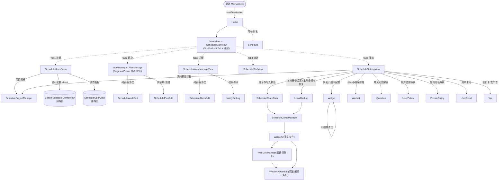

# 极简排班 3.5.0 · 导航规格 (navigation)

> 来源：`main/MainActivityKt.java`（NavHost 注册）、`main/Router.java`、`module/schedule/route/ScheduleRouter.java`、`module/base/router/WebDAVRouter.java`、`decoded/AndroidManifest.xml`。

## 1. 宿主与启动流程

- App 组件（manifest:56-67）：`HiltApplication` + 唯一 Activity `main.MainActivity`（LAUNCHER，theme `Theme.App.Starting`）+ `widget.MyAppWidgetReceiver`（APPWIDGET_UPDATE，provider `@xml/app_widget`）。
- Activity 内 Compose 树：`setContent { MainScreen(baseRepository, this) }`（`main/MainActivity.java:176`）。
- 启动序列（MainActivityKt.MainScreen, `main/MainActivityKt.java:83-133`）：
  1. `rememberNavController()`，NavHost startDestination = `Home`（:92, :177）。
  2. 读取 Intent extra `target_route` 并 `navigate(targetRoute)`（:112-113, :992-997）→ 深链机制。
  3. `LaunchedEffect(registDay)` 处理首次启动弹窗（:134）。
  4. `WorkplanTheme(darkTheme = appConfig.darkTheme)` 包裹 `Scaffold`（:135, :156）。
  5. 启动遮罩叠在导航之上（`MainView` 内 `startApp=false` 时全屏背景 + 右下角品牌区：`main/MainViewKt.java:110-147`）。首启有**隐私同意弹窗** `WelcomeDialog`（`DialogViewKt`；真机截图 `analysis/reference/real-screens/01-home.png`），点「同意」后进入首页；广告 SDK 另有 customController（MainActivity.java:390）。
  6. `MainScreen` 尾部再叠 `WelcomeDialog`（首启隐私同意）与 `UpdateIntroDialog`（版本变更，:756-849）。

## 2. 路由图（NavHost，共 20 个已注册 composable；另有 1 个未注册死路由 TestMainView）

### 2.1 全部路由常量（字符串即 route key）

| 路由 key | 常量位置 | 目标 composable | 参数 |
|---|---|---|---|
| `Home` | Router.java:26 | MainView → ScheduleMainView | — |
| `Schedule` | Router.java:111 | ScheduleMainView | — |
| `ScheduleProjectManage` | ScheduleRouter.java:25 | ScheduleProjectManagerView | — |
| `ScheduleWorkEdit` | ScheduleRouter.java:44 | ScheduleWorkEditView | Bundle: `model` = JSON(ScheduleWork) |
| `SchedulePlanEdit` | ScheduleRouter.java:55 | SchedulePlanEditView | Bundle: `model` = JSON(SchedulePlan) |
| `ScheduleAlarmEdit` | ScheduleRouter.java:66 | ScheduleAlarmEditView | Bundle: `model` = JSON(ScheduleAlarm) |
| `ScheduleCloudManage` | ScheduleRouter.java:77 | ScheduleCloudManageView | — |
| `ScheduleShareData` | ScheduleRouter.java:88 | ScheduleShareView | — |
| `Question` | Router.java:221 | QuestionView | — |
| `UserPolicy` | Router.java:67 | UserPolicy | — |
| `PrivatePolicy` | Router.java:56 | PrivatePolicy | — |
| `Wechat` | Router.java:276 | WechatView | — |
| `Widget` | Router.java:287 | WidgetConfigView | — |
| `UserDetail` | Router.java:232 | UserDetailView | — |
| `WebDAV` | Router.java:254 | WebDavDataView | Bundle: 可选（文件路径） |
| `WebDAVManage` | Router.java:243 | WebDAVUserManageView | — |
| `WebDAVUserEdit`（WebDAVRouter.UserEdit） | `module/base/router/WebDAVRouter.java` | WebDAVUserEditView | Bundle: `editInfo` JSON(WebDAVUser) |
| `LocalBackup` | Router.java:265 | LocalBackupView | — |
| `NotifySetting` | Router.java:298 | NotifySettingView | — |
| `Vip` | Router.java:210 | VipPage | — |

> 传参方式：`RouterKt.navigateTo(nav, route, bundleOf("model" to JSON.toJSONString(x)))`，目标屏 `entry.arguments?.getString("model")` 反序列化。证据：`ScheduleWorkManageViewKt.java:239`、`ScheduleAlarmManageViewKt.java:225`、`SchedulePlanManageViewKt.java:230`、`MainActivityKt.java:305,332,359`。

## 3. 底部 Tab 状态机（非 NavHost）

`ScheduleMasterViewModel`（Hilt ViewModel，主界面唯一状态源）：
- `pageType: FormType`（`ScheduleMasterViewModel.java:161`）
- `isHomePage()` = type=="home"；`isWorkPage()` = "work"；`isAlarmPage()` = "alarm"；`isStatPage()` = "stat"；`isSettingPage()` = "self"（:1513-1529）
- 点击 `NavItemView` → `setPageType(FormType("home"/"work"/"alarm"/"stat"/"self"))`（ScheduleMainViewKt.java:351-447）
- **Tab 切换不进入返回栈**：按返回键 = 退出 App（MainActivity 无 BackHandler 拦截；推断依据：全仓无 `BackHandler` 于主界面）。
- Tab2 内部再分「班次/轮班」二态：`formType.type` = `work`/`plan`，由 `SegmentPickerView(type, "班次","work","轮班","plan")` 切换（ScheduleMainViewKt.java:252-275）；`work`→ScheduleWorkManageView，`plan`→SchedulePlanManageView（:294-302）。

## 4. 页面容器与返回行为

`ui/component/nav/HeaderViewKt.java` 提供统一页面骨架（行号为 jadx .java 行号）：

| 容器 | 结构 | 用在哪 |
|---|---|---|
| `PageView(nav, title, navTools?, backAction?, content)` (HeaderView.kt) | 顶部返回箭头（IconFont.back 60000）+ 居中标题 + 右上工具位，内容区可滚动 | 分享与导入、云备份账号、我的文件、通知权限、我的信息、本地备份、桌面小组件、小程序导入 |
| `LazyAppPageView(nav, title, rightTool?, body)` (HeaderView.kt:155) | 同 PageView 但内容为 LazyColumn（大列表） | 常见问题解答 |
| `SimpleSubAppPageView(nav, header?, headerTitle, content)` | 无返回箭头；居中大标题；用于 Tab 页 | 班次提醒、排班统计、排班设置 |
| `PageWithFooterView(nav, title, header?, footerAction?, backAction?, content, footerHeight)` | 页面 + 固定底部按钮区 | 项目管理（底部「添加项目」「项目排序」） |
| `SelfHeaderView(nav?, backAction?, content)` | 自定义头部（无标题） | 班次 tab 顶部「班次/轮班」切换行 |
| `SelfPageView / SinglePageView / SubPageView / WithFooterView ...` | 其它变体（本 App 少量/未用） | — |
| `HeaderTitle(title)` | 居中标题文字 | 内部复用 |

返回：`PageView` 的返回箭头执行 `navHostController.popBackStack()`（推断自 HeaderViewKt 实现）。Tab 页无返回箭头，不属于返回栈。

## 5. 深链 / Intent

- 唯一深链机制：Intent extra `target_route`（`MainActivity.EXTRA_TARGET_ROUTE = "target_route"`，MainActivity.java:48）。
  - 处理：`MainActivityKt.java:112-113` 读取 → `LaunchedEffect` 中 `navController.navigate(targetRoute)` → 清除 extra（:994-997）。
  - 目前唯一发送方：桌面小组件日历点击 → `intent.putExtra(EXTRA_TARGET_ROUTE, Router.Widget.getRoute())`（`widget/calendar/WidgetCalendarViewKt.java:60`）。即「点小组件 → 打开 App 并直接进入小组件配置页」。
- 无 scheme/host 深链（manifest 中 MainActivity 仅 MAIN/LAUNCHER，无 `<data>`）。
- 通知/提醒：无自定义 Service/Receiver 声明；提醒通过 AlarmManager + 通知实现（推断：manifest 无对应组件，`ScheduleAlarm` 模型 + `util/CalendarReminderUtils.java` 负责系统日历/闹钟）。桌面小组件定时刷新走 Glance `updatePeriodMillis=1800000`（`decoded/res/xml/app_widget.xml`）。

## 6. 生命周期/刷新约定

- `BaseRepository.reload` / `isNeedReload` 控制全局数据刷新（`hilt/respo/BaseRepository.java` d2 元数据）；主界面进入或数据变更后调用。
- 小组件数据：App 修改排班后调用 `reloadWidget`/`prepareRefreshWidgetData` 通知 Glance 刷新（同上 d2；`widget/MyAppWidgetReceiver.java`）。
- 启动加载：`AppSettingViewModel.getStartApp()` 为 false 时显示全屏背景 + 右下角品牌区（约 200-300ms 后置 true）。
