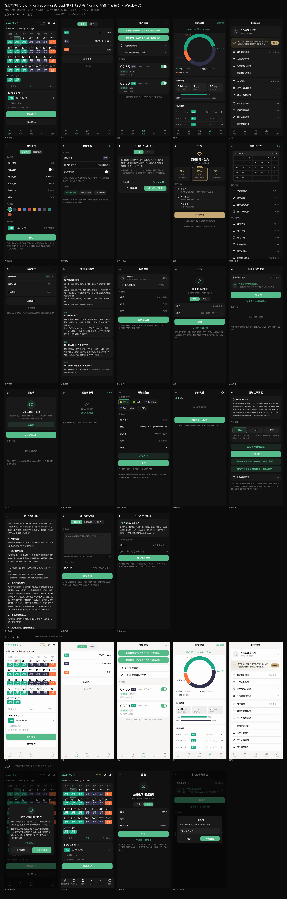
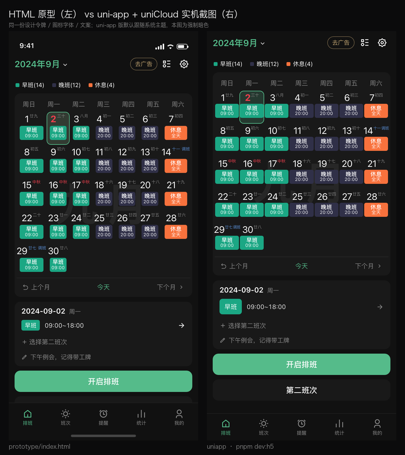

# 极简排班 3.5.0 · uni-app + uniCloud 复刻

> 把已反编译还原的「极简排班 3.5.0」（Android / Kotlin / Jetpack Compose）界面，用 **uni-app（Vue3 + Vite）+ uniCloud** 重新实现。
> 设计令牌（颜色/字号/圆角/图标/文案）全部取自 APK 本体；数据层支持本地 mock 与 uniCloud 云函数双后端。

## 1. 快速开始

    cd uniapp
    pnpm install          # 已完成
    pnpm dev:h5           # 开发：http://127.0.0.1:5273
    pnpm build:h5         # 产物：dist/build/h5

其他平台：

    pnpm dev:mp-weixin    # 微信小程序（用微信开发者工具打开 dist/dev/mp-weixin）
    pnpm dev:app          # App（HBuilderX 运行）

演示参数（仅 H5）：在 URL 加 ?theme=dark 或 ?theme=light 可强制主题，例如
http://127.0.0.1:5273/?theme=dark#/pages/home/index

## 2. 目录结构

    uniapp/
    ├─ src/
    │  ├─ pages/                 5 个 Tab 页（home 排班 / work 班次 / alarm 提醒 / stat 统计 / setting 我的）
    │  ├─ pages/sub/             8 个二级页（班次编辑 / 提醒编辑 / 分享导入 / 会员 / 小组件 / 项目 / FAQ / 我的信息）
    │  ├─ components/            共享组件（easycom 自动注册）
    │  │  ├─ page-frame/         页面骨架：顶栏 + 内容 + 可选自绘 tabbar + 主题 class
    │  │  ├─ app-tabbar/         底部 5 Tab（自绘，图标用 Remix Icon 字体）
    │  │  ├─ calendar-grid/      月历：7 列网格 / 农历 / 今天红字 / 选中绿 / 月水印 / 上-今天-下月
    │  │  ├─ shift-badge/        班次色块（日历内 badge / 列表 chip）
    │  │  ├─ donut-chart/        统计环形图（conic-gradient + 引线标签）
    │  │  ├─ seg-tabs/ app-switch/ cell-row/ ri-icon/ app-sheet/ app-dialog/
    │  ├─ composables/
    │  │  ├─ use-theme.js        主题模式（亮白/暗黑/跟随系统）+ 持久化
    │  │  ├─ use-store.js        全局响应式数据与动作（班次/排班/提醒/项目/配置）
    │  │  └─ use-nav.js          tab 切换（reLaunch）/ 二级页（navigateTo）/ 返回
    │  ├─ services/
    │  │  ├─ api.js              统一数据 API（uniCloud / 本地 mock 双后端）
    │  │  └─ local-db.js         本地后端（uni storage，含统计聚合）
    │  ├─ data/mock.js           示例数据（2024-09，取自官方截图）
    │  ├─ data/icons.js          Remix Icon 79 个码点（来自 APK 字体）
    │  ├─ styles/                tokens.scss（设计令牌）/ base.scss（全局组件类）/ icons.scss（base64 字体）
    │  ├─ config.js              后端开关（useCloud）
    │  └─ static/                App 图标、remixicon.ttf
    ├─ uniCloud-aliyun/          uniCloud 云函数 + 数据库 schema（阿里云版）
    ├─ UNICLOUD.md               云服务空间创建/绑定/部署步骤
    ├─ tools/                    自检与截图脚本（check-sfc.mjs / shoot.mjs）
    └─ shots/                    各页面截图

## 3. 与 APK / HTML 原型的对应

| uni-app 页面 | 路由 | APK Composables | HTML 原型 screen |
|---|---|---|---|
| pages/home/index | 排班 | ScheduleHomeView + ScheduleCalendarView | screenHome |
| pages/work/index | 班次 | ScheduleWorkManageView / SchedulePlanManageView | screenWork |
| pages/alarm/index | 提醒 | ScheduleAlarmManageView | screenAlarm |
| pages/stat/index | 统计 | ScheduleStatView + PieGraph | screenStat |
| pages/setting/index | 我的 | ScheduleSettingView | screenSetting |
| pages/sub/work-edit | 添加班次 | ScheduleWorkEditView | screenWorkEdit |
| pages/sub/alarm-edit | 添加提醒 | ScheduleAlarmEditView | screenAlarmEdit |
| pages/sub/share | 分享与导入 | ScheduleShareView | screenShare |
| pages/sub/vip | 会员 | VipPage | screenVip |
| pages/sub/widget | 桌面小组件 | WidgetConfigView | screenWidget |
| pages/sub/project | 项目管理 | ScheduleProjectManagerView | screenProject |
| pages/sub/faq | 常见问题 | QuestionView | screenFaq |
| pages/sub/user-detail | 我的信息 | UserDetailView | screenUserDetail |
| pages/sub/login | 登录 / 注册 | LoginDialog + uni-id | — |
| pages/sub/backup | 本地备份与恢复 | LocalBackupView / CommonCloudView | — |
| pages/sub/cloud | 云备份（uniCloud 快照） | CommonCloudView | — |
| pages/sub/webdav | 云备份账号 | WebDAVUserManageView | — |
| pages/sub/webdav-edit | 添加/编辑云备份 | WebDAVUserEditView | — |
| pages/sub/webdav-files | 我的文件 | WebDavDataView | — |
| pages/sub/permission | 通知权限设置 | NotifySettingView | — |
| pages/sub/agreement | 用户协议 / 隐私政策 | UserPolicy / PrivatePolicy | — |
| pages/sub/feedback | 用户在线反馈 | — | — |
| pages/sub/wechat | 导入小程序排班 | WechatView | — |

## 4. 设计系统（与 APK 一一对应）

| Token | 值（亮 / 暗） | APK 出处 |
|---|---|---|
| 页面背景 | #F6F5F4 / #111111 | ui/theme/ColorKt.java |
| 卡片面 | #FDFDFD / #191919 | 同上 |
| 选中/悬浮面 | #EEEEEE / #222222 | 同上 |
| 主/次/三级文字 | #000/#222/#999 / #FFF/#DDD/#888 | 同上 |
| 强调色 | #55BB8A（固定，无换肤） | ColorKt.ThemeColor |
| 删除/重要/VIP/私密 | #F87679 / #EE3F4D / #C5A874 / #806D9E | ColorKt |
| 字体 | 系统默认 | TypeKt.java（bodyLarge 16sp/24sp） |
| 圆角 | 卡片 12px，按钮 12px，小标签 4px | jadx RoundedCornerShape 统计 |
| 图标 | Remix Icon v4.3 子集 79 枚 | res/font/remixicon.ttf + IconFont.java |
| 主题色板 | 230 中国传统色 | assets/data/color.json（班次/小组件配色） |

实现位置：src/styles/tokens.scss；界面截图对照见 shots/ 与 ../prototype/shots/。

## 5. 数据层：本地 mock ⇄ uniCloud 一键切换

- 默认 config.js 的 useCloud=false：走 src/services/local-db.js（uni storage），开箱即用、可离线演示/截图。
- 改为 true 并完成 UNICLOUD.md 的绑定/部署步骤后：api.js 自动改为调用云函数 workplan，接口签名与返回结构完全一致，页面零改动。
- 云函数动作：bootstrap / schedule.range|set / shift.list|save|delete / alarm.list|save|toggle|delete / project.list|save|setCurrent|delete / config.get|save / stat.range / share.generate|import / faq.list；数据按 deviceId 隔离。

## 5.5 认证 / 云备份 / WebDAV（新增）

- uni-id 登录：官方 uni-id-common v1.0.16 + uni-config-center 已内置（uniCloud-aliyun/cloudfunctions/common/）；cloudfunctions/user 提供 register/login/logout/getInfo/updateInfo/changePassword，密码 pbkdf2-sha256 加盐，token 为 JWT；workplan/backup/webdav/feedback 云函数统一按 token 解析 uid，未登录回落 deviceId。详见 AUTH.md。
- 本地 / 云备份：本地备份存 uni storage；云备份快照存 uniCloud jy_backup（cloudfunctions/backup，服务端聚合 & 覆盖还原）。
- WebDAV：cloudfunctions/webdav 用 uniCloud.httpclient 真实访问 WebDAV（PROPFIND/PUT/GET/DELETE，Basic Auth，密码 AES-256-GCM 加密存 jy_webdav）；本地模式提供模拟数据可直接演示。
- 其他：通知/日历权限引导、用户协议/隐私政策、在线反馈（jy_feedback）、小程序排班导入、首启隐私弹窗（components/privacy-dialog，已在 page-frame 全局挂载）。

## 6. 开发辅助脚本

    node tools/check-sfc.mjs src/pages src/components   # SFC 语法自检（不启动构建）
    node tools/shoot.mjs --url "http://127.0.0.1:5273/?theme=dark#/pages/home/index" --out shots/home-dark.png
    # 交互态截图（脚本化点击/填表）：
    node tools/shoot.mjs --url ".../pages/sub/login/index" --out shots/x.png --actions-file /tmp/actions.json

（shoot.mjs 需先以 --remote-debugging-port=9222 启动 Chrome headless）

## 7. 截图（shots/，H5 390x844 2x 实测）

> 共 23 个页面：5 Tab（排班/班次/提醒/统计/我的）+ 18 二级页；截图均为 H5 390x844@2x 实测。

与 HTML 原型的同屏对照：

| 文件 | 内容 |
|---|---|
| shots/gallery_board.png | 全部页面总览（暗色 5 Tab + 8 二级页 / 亮色 5 Tab / 交互态） |
| shots/{home,work,alarm,stat,setting}-dark.png | 5 个 Tab 暗色 |
| shots/{home,work,alarm,stat,setting}-light.png | 5 个 Tab 亮色 |
| shots/sub-{work-edit,alarm-edit,share,vip,widget,project,faq,user-detail}-dark.png | 8 个二级页 |
| shots/sub-{login,backup,cloud,webdav,webdav-edit,webdav-files,permission,agreement,feedback,wechat}-dark.png | 新增业务页：登录 / 本地备份 / 云备份 / WebDAV 账号·编辑·我的文件 / 通知权限 / 用户协议 / 在线反馈 / 小程序导入 |
| shots/privacy-first-launch.png | 首启隐私弹窗 |
| shots/home-edit-dark.png / setting-style-sheet.png / home-month-sheet.png | 排班模式 / APP风格弹层 / 月份选择 |

## 8. 已知差异 / 限制

1. H5 没有系统状态栏；App/小程序由系统绘制。HTML 原型里的仿真状态栏未移植。
2. 统计环形图用 CSS conic-gradient 实现（H5/App 正常；低版本微信基础库若不支持，可换 canvas 版本）。
3. 图标字体内联 base64（22KB），兼容小程序对本地字体的限制。
4. Tab 切换用 uni.reLaunch（自绘 tabbar 以获得像素级还原），未使用原生 tabBar；如需原生 tabBar 可换 iconPath 图片方案。
5. uniCloud 需要 HBuilderX 关联服务空间并上传云函数后才能启用；未绑定时自动回落本地 mock。
6. 用户体系：演示版以 deviceId 隔离数据，未接入 uni-id 登录；接入方式见 UNICLOUD.md。
7. 轮班 Tab：示例数据未包含轮班（plans），按空态「暂无轮班」渲染；接口与页面结构已就绪，补数据即可。
8. 属性面板类功能（班次排序 / 导出 Excel / 统计区间选择）原型是弹窗，本工程暂以 toast「功能演示」占位；排序与导出的接口位已留。
9. 时长统计里的分班次进度条（126h / 144h）沿用原型固定比例（api.computeStat 目前只返回总时长/平均/休息）。
10. 统计环形图使用共享 donut-chart（CSS conic-gradient），与原型手绘 SVG 的起止角度略有差异。
11. H5 无系统状态栏，整页较原型上移约 44px；App/小程序 由系统状态栏占位。

## 官方真机像素对照

- `analysis/reference/real-screens/`：Android 14 模拟器安装官方 APK 后抓取的 24 张官方界面（浅色+暗色）
- `compare-real-vs-uniapp-main.png` / `compare-real-vs-uniapp-sub.png`：官方 vs 本复刻版的左右对照板
- 已知差异：H5 无系统状态栏/三键导航，页面整体少约 48dp 安全区；真机为空态数据，复刻截图含演示数据

## 广告开关（无广告模式）

`src/config.js` 中 `noAds: true`（默认）：

- 首页右上角隐藏「去广告」入口；
- 会员页过滤「无广告秒开」权益，副标题改为「支持独立开发，解锁专属客服」；
- 本项目不接入任何广告 SDK；设为 `false` 可恢复官方原样用于像素对比。

## 提醒 / 系统日历（原生能力）

复刻原 App 的提醒方案：写入系统日历，由系统准时通知。App 端通过 `plus.android` 直接调用 CalendarContract / NotificationManager / AlarmManager，**无需 UTS 插件或自定义基座**；H5 自动降级。

- 服务：`src/services/reminder.js`（权限诊断、日历写入/更新/删除、测试提醒、通知、跳系统设置）
- 页面：提醒编辑页「同步到系统日历」开关、提醒列表联动、权限页真实权限诊断
- 文档：[REMINDER.md](REMINDER.md)

## 桌面小组件（App 端）

复刻原 App 的 Glance 小组件：月历 + 班次两个桌面组件。App 端为「JS 数据层 + 原生 AppWidgetProvider」。

- 服务：`src/services/widget.js`（配置持久化、月历载荷、SharedPreferences 写入 + 刷新广播、实例诊断）
- 配置页：`src/pages/sub/widget/index.vue`（实时预览、显示项/字号/配色、保存并刷新、添加指引）
- 原生插件：`nativeplugins/uni-widget/`（两个 Provider + 布局 + 清单，需 Android Studio 构建 AAR）
- 文档：[WIDGET.md](WIDGET.md)；截图：`shots/widget-config.png`

## 会员（赞助）与支付

本项目不接入广告；会员定位为「赞助开发者」，权益为 支持开发 / 专属客服 / 会员标识，支付走支付宝 App 支付（mock 模式可本地演示）。

- 云函数：`uniCloud-aliyun/cloudfunctions/vip`（订单/会员状态/支付宝 RSA2 签名/验签/mock）
- 集合：`jy_vip`、`jy_vip_order`（`database/` 内 schema，客户端不可直连）
- 配置：`common/uni-config-center/vip/config.json`（方案价格、支付宝密钥、`mock` 开关）
- 客户端：`src/composables/use-vip.js`、`src/pages/sub/vip/index.vue`、我的页会员卡片
- 完整接入步骤（支付宝开放平台、密钥、异步通知、mock、上线注意事项）：[PAYMENT.md](PAYMENT.md)
- 流程截图：`shots/vip-flow.png`、`shots/vip-mock-modal.png`、`shots/vip-active.png`、`shots/setting-member.png`
